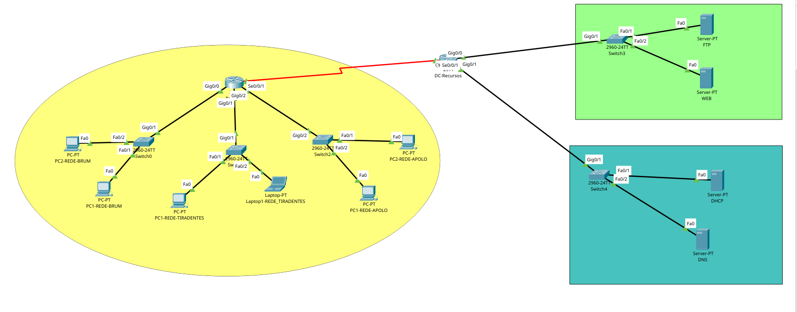

# Topologia de Redes com DHCP Relay, DNS e Roteamento dinâmico

Projeto de infraestrutura de redes desenvolvido utilizando Cisco Packet Tracer 9.0, com o objetivo de implementar a comunicação entre redes locais (LANs) e um Data Center centralizado, disponibilizando serviços de infraestrutura por meio de roteamento estático, DHCP Relay e DNS.

Diciplina: **Infraestrutura de Comunicação** \
Professor: **Jymmy Barreto**

Projeto de infraestrutura de redes desenvolvido utilizando Cisco Packet Tracer 9.0, com o objetivo de implementar a comunicação entre redes locais (LANs) e um Data Center centralizado, disponibilizando serviços de infraestrutura por meio de roteamento estático, DHCP Relay e DNS.

### 📌 Sobre o projeto

A topologia foi desenvolvida a partir de uma infraestrutura composta por três redes locais de usuários:

LAN-BRUM

LAN-TIRADENTES

LAN-APOLO

A infraestrutura foi expandida com a implementação de um Data Center de Recursos (DC-Recursos), responsável por centralizar serviços de rede, incluindo DHCP, DNS, WEB e FTP.

A comunicação entre o roteador principal (RT-01) e o Data Center ocorre por meio de um enlace serial ponto a ponto.

### 🖥️ Topologia da rede

A infraestrutura está dividida em três segmentos principais:

1. Redes de usuários

    BRUM

    TIRADENTES

    APOLO

2. LAN de serviços WEB

    Servidor FTP

    Servidor WEB

3. LAN de serviços de rede

    Servidor DNS

    Servidor DHCP

🛠️ Conceitos utilizados

- IPv4 e subnetting
- DHCP e processo DORA
- DHCP Relay (ip helper-address)
- DNS (Domain Name System)
- FTP (File Transfer Protocol)
- HTTP (Hypertext Transfer Protocol)
- Roteamento dinâmico
- Modelos OSI e TCP/IP

